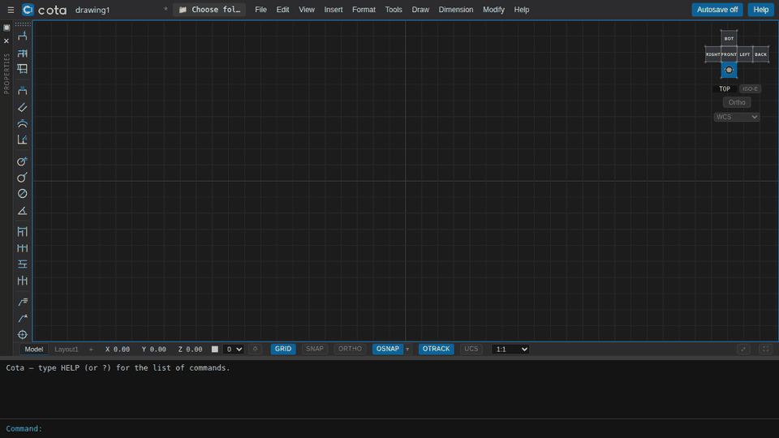
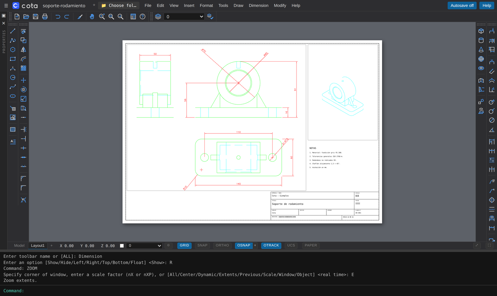

<div align="center">

<picture>
  <source media="(prefers-color-scheme: dark)" srcset="docs/images/cota-logo-dark.svg">
  
</picture>

**Draw it, model it, dimension it.**<br>
**A free, open-source 2D + 3D CAD that runs in your browser.**

Command-line driven drafting, real 3D solids and full drawing production —
no install, no account, no license fee.

[**Try it now**](https://mxchristian17.github.io/cota/) ·
[Getting started](docs/getting-started.md) ·
[User guide](docs/user-guide.md) ·
[Command reference](docs/commands.md) ·
[Self-hosting](docs/self-hosting.md)




</div>

## Why Cota

*Cota* is the Spanish word for a dimension on a technical drawing — the number that turns a sketch into a part
you can build.

- **It works the way CAD users already work.** Type `LINE`, `CIRCLE`, `EXTRUDE`, `TRIM`… and follow the
  prompts. Absolute, relative and polar coordinates, object snaps, ortho, tracking, grips and right-click
  as Enter. If you have used a classic desktop CAD, you already know how to use Cota.
- **2D and 3D in the same drawing.** Draft profiles, extrude or revolve them into solids, combine them with
  booleans, fillet and chamfer their edges, rotate, mirror and array them in any view.
- **From model to drawing sheet.** Layouts with scaled viewports, projected views generated from the
  3D model, hidden lines, shaded views, automatic dimensioning, title blocks with fields, and vector PDF output.
- **Runs anywhere.** It is a static web app: open it in a browser and start drawing, or install it as an app with
  its own window that works offline. Your drawings are plain `.cota` files on your own disk. An optional server
  adds accounts, cloud storage and DWG conversion.
- **Free and open.** Apache-2.0. Use it at work, at school or at home, modify it and ship it.



## Features

| Area | What you get |
| --- | --- |
| **Drafting** | Line, polyline (with arcs and widths), arc, circle, ellipse, spline, polygon, rectangle, text and multiline text, hatch (patterns, solid fill, islands, associative), blocks with attributes |
| **Editing** | Move, copy, rotate, scale, mirror, offset, stretch, lengthen, trim, extend, break, join, fillet, chamfer, array (rectangular and polar), align, explode, match properties, grips |
| **Precision** | Snap, ortho, object snaps (endpoint, midpoint, center, geometric center, node, quadrant, intersection, perpendicular, tangent, nearest), object snap tracking, user coordinate systems, measuring |
| **3D modeling** | Box, cylinder, cone, sphere, torus, extrude, revolve, union / subtract / intersect, fillet and chamfer edges, 3D-aware rotate, mirror and array in any view, visual styles (wireframe, hidden, shaded, shaded with edges), unfolded view cube (first or third angle), perspective, multiple viewports, named views |
| **Dimensioning** | Linear, aligned, angular, arc length, radius, diameter, jogged, ordinate, baseline, continue, quick and **automatic** dimensioning, leaders and multileaders, center marks, dimension styles, annotative scales, associative dimensions |
| **Drawing production** | Layouts and paper space, scaled viewports, base and projected views from the 3D model, profiles and flat shots, shaded views, title blocks with fields and attributes, page setup, plot and multi-page publish to vector PDF with lineweights |
| **Interface** | 23 classic toolbars with icons (dockable on any edge or floating), menus for every command, command line with history and completion, clean screen, full screen; your setup is remembered |
| **Organization** | Layers (color, linetype, lineweight, freeze, lock, plot), linetype library, layer tools, drawing properties |
| **Files** | Native `.cota` (JSON), DWG opening in the browser (no server), DXF import and export, OBJ import and export, STL, STEP and IGES opening, PDF |
| **App** | Installable (PWA): own window without the address bar, desktop shortcut, works offline |
| **Optional server** | Accounts, documents stored in a database, DWG ↔ DXF conversion, natural-language modeling with your own LLM key |

See the full list of **240+ commands** in the [command reference](docs/commands.md).

## Quick start

### Use it online

Open **<https://mxchristian17.github.io/cota/>**. Everything runs in your browser; nothing is uploaded.
Save with `SAVE` (it downloads a `.cota` file) or pick a folder on your disk with `OPENFOLDER`. In Chrome or
Edge, click **Install app** to get it in its own window, with a desktop shortcut and offline use.

### Run it locally

You need [Node.js](https://nodejs.org/) 20 or newer.

```bash
git clone https://github.com/mxchristian17/cota.git
cd cota/services/web
npm install
npm run dev
```

Open <http://localhost:5173>. To run it with the optional server (accounts, cloud storage, DWG), use Docker:

```bash
docker compose -f docker-compose.dev.yml up --build
```

More options in [self-hosting](docs/self-hosting.md).

## Your first drawing in one minute

Type these in the command line at the bottom (press <kbd>Enter</kbd> after each line):

```text
RECTANGLE 0,0 @100,60
EXTRUDE            click the rectangle, Enter, 10
CYLINDER 30,30 10 30
VIEW SWISO
SUBTRACT           click the plate, Enter, click the cylinder, Enter
VSCURRENT SHADEDEDGES
```

You now have a plate with a hole. Continue with the [getting started guide](docs/getting-started.md).

## Documentation

- [Getting started](docs/getting-started.md) — install, first drawing, saving and opening
- [User guide](docs/user-guide.md) — command line, coordinates, selection, precision, layers, 3D,
  dimensions, layouts and plotting, keyboard and mouse
- [Command reference](docs/commands.md) — every command, alias and system variable
- [Examples](examples/) — sample drawings you can open
- [Self-hosting](docs/self-hosting.md) — static hosting, Docker, the optional server and its settings
- [Architecture](docs/architecture.md) — how Cota is built, for contributors
- [Roadmap](ROADMAP.md) · [Contributing](CONTRIBUTING.md) · [Changelog](CHANGELOG.md) · [Security](SECURITY.md)

## Built with

TypeScript, React, Vite, [Three.js](https://threejs.org/), three-bvh-csg and Zustand in the browser;
Python, FastAPI, SQLModel and Alembic for the optional server; DWG files are read in the browser with
[acad-ts](https://github.com/node-projects/acad-ts) (MIT, a TypeScript port of ACadSharp), and saving DWG goes
through [GNU LibreDWG](https://www.gnu.org/software/libredwg/) when it is installed on the server. See
[THIRD_PARTY_NOTICES.md](THIRD_PARTY_NOTICES.md).

## Contributing

Bug reports, feature requests and pull requests are welcome. Read [CONTRIBUTING.md](CONTRIBUTING.md) and the
[Code of Conduct](CODE_OF_CONDUCT.md) first. If Cota is useful to you, a ⭐ on GitHub helps others find it.

## Privacy

The online demo has no accounts, cookies, analytics or trackers. Your drawings and settings stay in your
browser (or in the folder you choose). The site is hosted by GitHub Pages, which keeps its own server logs under
the [GitHub Privacy Statement](https://docs.github.com/en/site-policy/privacy-policies/github-general-privacy-statement).
If you run the optional server, you are responsible for the data it stores; the AI feature sends your prompts
to the provider whose API key you configure.

## No warranty

Cota is provided "as is", without warranty of any kind (sections 7 and 8 of the license). Check dimensions and
drawings before you manufacture or build from them. Geometry proposed by the AI feature can be wrong, and DWG
conversion can lose data (3D solids stored as ACIS data are not read).

## License and credits

Cota is created and maintained by **[Christian Orengia](https://github.com/mxchristian17)**.

Licensed under the [Apache License 2.0](LICENSE). Redistributions must retain the attribution notices in the
[NOTICE](NOTICE) file, which credit the original author. The name and logo are covered by the
[trademark policy](TRADEMARKS.md). If you use Cota in academic work, please cite it
([CITATION.cff](CITATION.cff)).

Cota is an independent project. It is not affiliated with, endorsed by or sponsored by any CAD vendor.
DWG and DXF are trademarks of Autodesk, Inc.; they are used here only to name file formats. All other product
names and trademarks belong to their respective owners.
