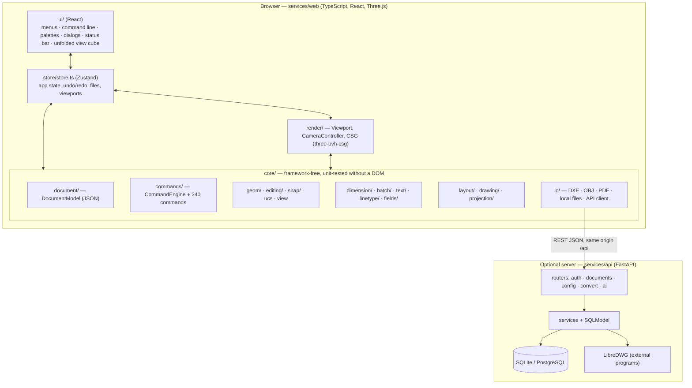

# Architecture

Cota is a **thick client with an optional thin server**. The whole CAD engine (document, commands,
geometry, snapping, rendering, booleans, dimensions, layouts, file formats and PDF) runs in the browser. The
Python server only stores users and drawings, converts DWG and calls LLMs.



## Repository layout

```text
services/web/          Web app (the CAD)
  src/core/            CAD engine, no React or Three.js dependencies in most modules
  src/render/          Three.js viewports, cameras, CSG evaluation
  src/ui/              React components
  src/store/store.ts   Application state and the glue between UI, engine and renderer
  tests/e2e/           Playwright end-to-end tests
services/api/          Optional server
  app/routers/         HTTP endpoints
  app/services/        Business logic (documents, auth, DWG, LLM pipeline)
  app/models/          SQLModel tables
  alembic/             Database migrations
  tests/               pytest
docs/                  Documentation
examples/              Sample drawings
```

## The document

`core/document/` holds the **DocumentModel**: the single source of truth, serialized as JSON in `.cota`
files and in the database. It contains layers, linetypes, UCSs, named views, dimension and multileader
styles, block definitions, layouts (paper space with their entities and page setup), system variables and the
model-space entities.

Entities are **parametric**: a `CIRCLE` stores center, radius and normal; a `SOLID3D` stores a tree of
operations (`BOX`, `CYLINDER`, `EXTRUDE`, `REVOLVE`…, combined by `UNION` / `SUBTRACT` / `INTERSECT` and
modified by `FILLETEDGE` / `CHAMFEREDGE`). Meshes are never stored; they are recomputed deterministically when
a drawing is opened. Every change increments `doc.revision`, which is how the renderer knows it has to redraw.

Other entity types are `LINE`, `ARC`, `POLYLINE` (with bulges and widths), `RECTANGLE`, `ELLIPSE`, `SPLINE`,
`TEXT` (single-line and multiline), `HATCH`, `INSERT` (block references, also used for drawing views), `ATTDEF`,
`DIMENSION` (including leaders), `VIEWPORT`, `SHADE` (shaded drawing views) and `MESH3D` (imported meshes).

## The command engine

`core/commands/CommandEngine.ts` is a small interpreter. A command is an object with a name, aliases, a
description and an async `run(ctx)` function:

```ts
export const circleCommand: Command = {
  name: 'CIRCLE',
  aliases: ['C'],
  description: 'Draw a circle: center + radius/Diameter, 3P, 2P or Ttr',
  async run(ctx) {
    const center = await ctx.getPoint('Specify center point for circle or [3P/2P/Ttr]: ', { keywords: ['3P', '2P', 'Ttr'] })
    // …
    ctx.doc.addEntity({ type: 'CIRCLE', layer: ctx.currentLayerId(), props: { center, radius } })
  },
}
```

`ctx.getPoint`, `getDistance`, `getAngle`, `getString`, `getSelection` and their variants suspend the command
until the user answers, by typing or by clicking. The engine resolves the input in one pipeline: coordinate
parsing (`coords.ts`, UCS-aware), object snaps, ortho and tracking, selection sets and keyword matching.
Commands also receive `ctx.app`, a narrow interface to the application (views, files, dialogs).

To add a command:

1. Create it in `core/commands/impl/`.
2. Register it in `core/commands/registry.ts`.
3. Add it to a menu in `core/ui/menus.ts`.
4. Write unit tests with the engine harness (`src/test/engineHarness.ts`), which runs commands headless with
   scripted input.
5. Regenerate the reference: `UPDATE_DOCS=1 npx vitest run commandsDoc`.

`HELP` and the command reference are generated from the registry, so they are always in sync.

**Undo/redo** works by document snapshots taken around every command that changes the document. View changes
are recorded in the same history.

## Rendering

`render/Viewport.ts` owns a Three.js scene per viewport. It runs a render loop that re-syncs the scene when
`doc.revision` changes, so commands never talk to the renderer directly. It also handles picking (raycasting
plus screen-space tests), grips, the crosshair, snap glyphs and previews of the command in progress.

- **Cameras** (`CameraController`): orthographic and perspective around an orbit target; standard and
  named views; zoom history.
- **Booleans** (`render/csg.ts`): the solid tree is evaluated with three-bvh-csg and cached by content.
  Fillets and chamfers of edges derive the topology from the mesh (`core/editing/topology.ts`) and add or
  subtract swept tools.
- **Visual styles:** wireframe 2D/3D, hidden, shaded and shaded with edges, per viewport.
- **Snapping** (`core/snap/`) is measured in screen pixels through the camera projection, so it works on 3D
  geometry in any view.

## Annotation and drawing production

- `core/dimension/`: dimension geometry, formatting, styles (`DIM*` variables and overrides),
  associativity and automatic dimensioning (`autodim.ts`).
- `core/hatch/`: boundary detection with islands, pattern library and fills.
- `core/text/`: single-line and multiline text with a stroke font for exact output.
- `core/layout/`: paper sizes, page setup, viewport scaling and clipping, templates and the title block.
- `core/drawing/` and `core/projection/`: drawing views from the 3D model — orthographic projection with
  visible and hidden edges, silhouettes, shading.
- `core/io/pdf.ts`: a dependency-free vector PDF writer; `layoutPlot.ts` plots a sheet at 1:1 with
  viewport clipping, lineweights and plot styles.

## Interface, preferences and the installable app

- **Toolbars:** `core/ui/toolbars.ts` defines the 23 toolbars as data (buttons are command macros, Object Snap
  buttons are transparent overrides, combos for layer, linetype and dimension style). `core/ui/toolbar.ts` holds the
  pure docking logic (several toolbars per edge, order, floating position) and `ui/Toolbar.tsx` renders the docks,
  floating toolbars, the context menu and the TOOLBAR dialog. Icons are hand-drawn SVG in `ui/icons.ts`.
- **Preferences:** `core/ui/prefs.ts` stores the interface and display setup in `localStorage` with a timestamp;
  with a session, the same object goes to `PUT /config`, and at sign-in the most recent copy wins.
- **App:** `public/manifest.webmanifest` makes it installable; `tools/serviceWorker.ts` is a Vite plugin that emits
  `sw.js` at build time with the list of that build's files (registered only in production). `ui/appWindow.ts`
  handles the install prompt and full screen (Fullscreen API with Keyboard Lock for <kbd>Esc</kbd>).

## Files and storage

- `core/io/dxf*.ts` and `core/io/obj.ts` read and write DXF and OBJ in the browser.
- `core/io/fileSystem.ts` uses the File System Access API for a working folder on disk.
- `core/io/apiClient.ts` talks to the server same-origin under `/api` (the Vite dev server or Nginx proxies it),
  so no CORS setup is needed. `core/io/backend.ts` turns the server features off when the app is built with
  `VITE_CLOUD=off`.

## The server

FastAPI, SQLModel, Alembic. Endpoints (all under `/api` when proxied):

| Router | Endpoints |
| --- | --- |
| `auth` | `POST /auth/register`, `POST /auth/login`, `POST /auth/logout`, `GET /auth/me` |
| `documents` | `GET/POST /documents`, `GET/PUT/DELETE /documents/{id}` |
| `config` | `GET/PUT /config` (user settings) |
| `convert` | `GET /convert/status`, `POST /convert/dwg-to-dxf`, `POST /convert/dxf-to-dwg` |
| `ai` | `GET/PUT /ai/config`, `POST /ai/generate`, `POST /ai/generate/stream` |
| system | `GET /health` |

Sessions are JWTs in an HTTP-only cookie. User LLM keys are encrypted with Fernet. In production the server
fails to start with default secrets, SQLite or no host allowlist. See [self-hosting](self-hosting.md).

## Testing

| Suite | Command | Scope |
| --- | --- | --- |
| Unit (web) | `npm test` in `services/web` | Engine, geometry, commands (headless), file formats, PDF |
| End-to-end | `npx playwright install chromium` once, then `npm run test:e2e` | The app in a real browser, driven like a user |
| Types | `npm run typecheck` | |
| Server | `.venv/bin/pytest` in `services/api` | Endpoints and services |
