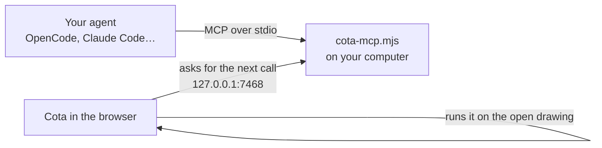

# External agents (OpenCode, Claude Code, Codex…)

An agent that runs on your computer can work on the drawing you have open in Cota, with the model it is configured
to use (DeepSeek, a local model, or any other). It gets the same tools as Cota's own agent: it runs commands, reads the
drawing, selects, changes properties, looks at the view and undoes. You watch each change happen in Cota.

The link is the **Cota bridge**, `cota-mcp.mjs`: a small script, with no dependencies, that your agent starts as an
[MCP](https://modelcontextprotocol.io) server. Cota connects to it on your computer (`http://127.0.0.1`).



## 1. Get the bridge

Download [`cota-mcp.mjs`](https://mxchristian17.github.io/cota/cota-mcp.mjs) (also linked in the agent panel ⚙ ▸
**External agent**) and keep it somewhere stable, e.g. `~/cota/cota-mcp.mjs`. It needs Node 18 or later (or Bun).

## 2. Add it to your agent

**OpenCode** — in `opencode.json` (your project) or `~/.config/opencode/opencode.json`:

```json
{
  "$schema": "https://opencode.ai/config.json",
  "mcp": {
    "cota": {
      "type": "local",
      "command": ["node", "/home/you/cota/cota-mcp.mjs", "--text-only"],
      "enabled": true
    }
  }
}
```

Pick the model in OpenCode as usual (for DeepSeek: add your DeepSeek key with `opencode auth login` and choose it with
`/models`). `--text-only` leaves the pictures of the view out of the results: use it with models that read text only,
such as DeepSeek; leave it out with models that see images.

**Claude Code**:

```bash
claude mcp add cota -- node /home/you/cota/cota-mcp.mjs
```

**Codex** — in `~/.codex/config.toml`:

```toml
[mcp_servers.cota]
command = "node"
args = ["/home/you/cota/cota-mcp.mjs"]
```

Any other MCP client works the same way: the command is `node /path/to/cota-mcp.mjs`.

## 3. Connect Cota

Open Cota, open the agent panel (**AGENT**), press ⚙ and, under **External agent**, press **Connect**. The panel shows
**External agent connected** once your agent is running. The browser may ask to let the page reach devices on your
local network: allow it (the bridge is on your own computer). Cota stays connected after reloading until you press
**Disconnect**.

## 4. Ask your agent

For example: *"In Cota, draw a 100 × 60 plate with four Ø8 holes 10 mm from the corners, then extrude it 5 mm"*. The
agent reads Cota's guide first (`read_doc` "intro") and works with scripts of commands.

- With **Ask before running** (the panel's default) each script waits for you to press **Run**; the agent is told
  when you reject one. **Run automatically** lets it work alone. Each script is one undo step.
- The agent's steps are listed in the panel.

## Options

| Option | What it does |
| --- | --- |
| `--port 7468` | Port where Cota connects; set the same one in the panel. Use another if 7468 is taken or you run two agents |
| `--text-only` | No pictures in the results (models that read text only) |
| `--origin https://cota.example.com` | Lets a self-hosted Cota connect (repeat for more). The public Cota and pages on `localhost` are always allowed |

## Safety

- The bridge listens only on `127.0.0.1` and answers only Cota pages: the browser sends the page's address with every
  request and no other web page can use the bridge. It sends nothing to the Internet.
- What the tools return (descriptions of the objects, pictures of the view) goes to your agent and from there to the
  model it uses.
- Cota keeps its own undo: anything the agent does can be undone.
